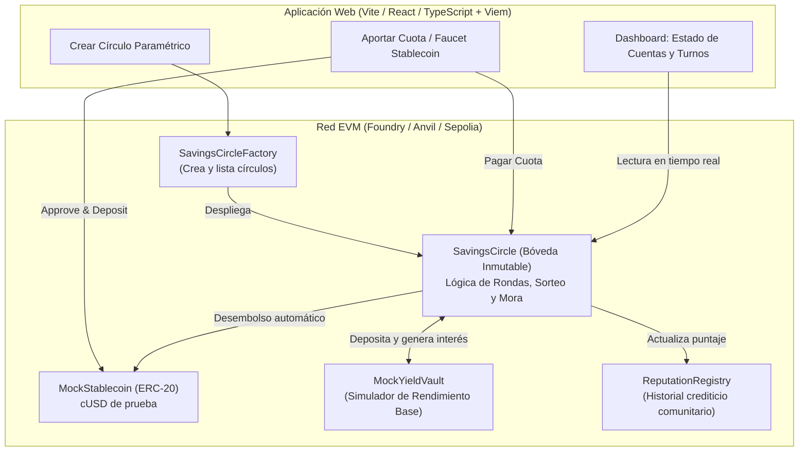
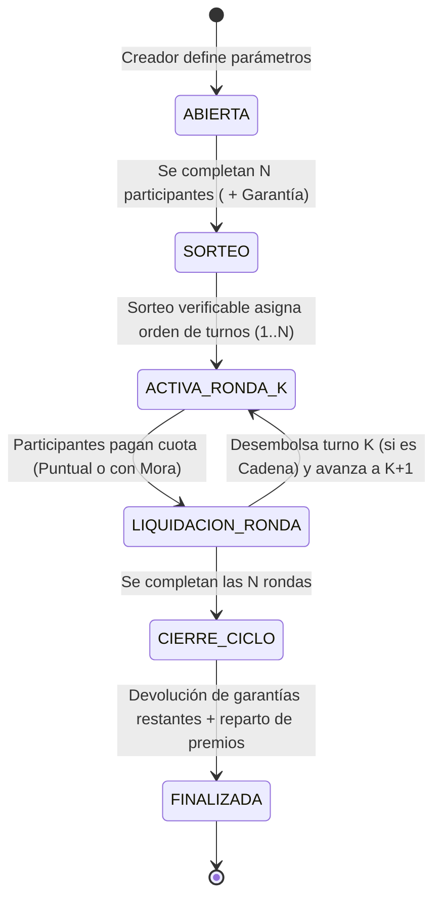

# Análisis del Proyecto #3: Círculos de Ahorro Comunitario (Blockchain)

> Este documento conserva la estructura del planteamiento inicial y refleja las reglas implementadas. La [revisión y correcciones](./docs/REVISION_BLOCKCHAIN_Y_SORTEO.md) detalla el sorteo asíncrono y sus límites. La demo local no requiere contratar un proveedor externo: su fuente es simulada y no acredita imparcialidad frente a quien envía la respuesta.

## 1. Comprensión del Problema y Contexto
En Latinoamérica (especialmente en Colombia), existen dos variantes principales de ahorro comunitario mencionadas en el enunciado:
1. **La "Cadena" o Pasanaku (ROSCA - *Rotating Savings and Credit Association*):** Un grupo de $N$ participantes aporta una cuota fija cada periodo. En cada ronda, uno de los participantes recibe el pozo acumulado de ese periodo (adjudicado por sorteo o turno). El ciclo termina cuando todos han recibido el pozo una vez.
2. **La "Natillera" (ASCA - *Accumulating Savings and Credit Association*):** Los participantes aportan periódicamente a un fondo común que genera rendimientos durante todo el ciclo (ej. 6 o 12 meses), y al cierre del ciclo se liquida y reparte el capital más los rendimientos proporcionales (premiando la puntualidad).

### Problemas del modelo tradicional que resolvemos con Blockchain:
| Riesgo Tradicional | Solución en Smart Contract |
| :--- | :--- |
| **Riesgo de custodia / Robo / Embargo al tesorero** | **Bóveda Inmutable (Escrow descentralizado):** Los fondos residen en el contrato inteligente, sin que ningún administrador pueda retirarlos arbitrariamente. |
| **Morosidad (especialmente quien cobra primero en una cadena)** | **Garantía (Colateral) + Reglas Anti-Mora:** Depósito de garantía inicial, penalizaciones automáticas sobre rendimientos o colateral, y sistema de reputación on-chain. |
| **Falta de transparencia en turnos y cuentas** | **Sorteo Verificable y Contabilidad Pública:** Orden de turnos determinístico/verificable y trazabilidad en tiempo real de quién ha pagado y cuánto rendimiento hay acumulado. |
| **Pérdida de valor por inflación** | **Simulación de activos estables y rendimiento:** El token `cUSD` y la bóveda permiten demostrar la contabilidad; no prueban respaldo monetario ni protección real frente a inflación. |

---

## 2. Desglose de Requerimientos Funcionales

A partir de la sección **"Propuesta"** y **"Rol de Blockchain"**, el prototipo debe cubrir 5 pilares:

### A. Creación Paramétrica de Círculos (Patrón Factory)
El sistema debe permitir crear múltiples círculos de ahorro configurando:
- **Monto de la cuota (`contributionAmount`):** Valor en tokens estables (ERC-20) a pagar por periodo.
- **Número de participantes (`maxParticipants`):** Cupo del círculo (ej. 5 o 10 personas).
- **Periodicidad (`roundDuration`):** Duración de cada ronda en segundos; la interfaz la configura en días y permite avanzar el reloj de Anvil para la demostración.
- **Modalidad / Reglas de adjudicación (`payoutMode`):**
  - *Modo Turnos (Cadena / ROSCA):* Desembolso en cada ronda según orden sorteado.
  - *Modo Cierre de Ciclo (Natillera):* Acumulación total y desembolso masivo al finalizar todas las rondas.
- **Depósito de garantía / Penalización por mora (`collateralAmount` / `latePenaltyBps`):** La garantía mínima es `N * (cuota + multa)`, suficiente para cubrir todas las cuotas y multas del ciclo.

### B. Gestión de Aportes en Activos Estables (ERC-20)
- Un contrato **Token Estable de Prueba** (`MockStablecoin`, símbolo `cUSD`, con función *faucet* para obtener saldo de demostración).
- Registro de pagos por ronda (`round -> participant -> paidStatus`).
- Ventana de pago puntual vs. ventana de pago con recargo/mora.

### C. Reglas Anti-Mora y Reputación
Para atacar el problema clásico donde alguien recibe el primer turno de la cadena y deja de pagar:
1. **Fondo de Garantía y Puntos de Puntualidad:** Al unirse se deposita la garantía. Cada cuota pagada puntualmente suma un punto para el reparto de premios; inscribirse o pagar tarde no otorga puntos.
2. **Penalización Automática:** Si un participante paga tarde (mora) o incumple:
   - Paga una multa extra y no gana un punto por esa ronda. Conserva los puntos de otras rondas.
   - Esa multa/rendimiento se redistribuye por **pagos puntuales**, según los puntos acumulados; si nadie tiene puntos, se reparte por igual.
3. **Score de Reputación (inspirado en el paper de Berkeley de los recursos):** Registra el historial de pagos y círculos de una wallet. El prototipo lo muestra y lo utiliza para permitir avales; no impone acceso a círculos por monto ni verifica identidad personal.

### D. Simulación de Rendimiento Base (Mock DeFi Yield)
- Al liquidar cada ronda se aplica `yieldRateBps` al principal bloqueado en `MockYieldVault`. Es una tasa por ronda, no un APY ni una tasa prorrateada por tiempo. Los intereses no se reinvierten.
- Al cerrar el ciclo se devuelven las garantías restantes y, en ASCA, los aportes acumulados. Los rendimientos y multas se reparten según los puntos de puntualidad; si nadie tiene puntos, se reparten por igual.

### E. Sorteo Verificable y Desembolso Automático
- **Sorteo de turnos:** Cierre de inscripciones, solicitud de aleatoriedad externa y finalización posterior mediante Fisher-Yates con muestreo por rechazo. VRF en una red compatible; proveedor simulado identificado en Anvil.
- **Liquidación:** Cualquier dirección puede enviar la transacción al vencer el plazo o completarse los pagos. Esa transacción ejecuta los desembolsos programados; el paso del tiempo por sí solo no ejecuta el contrato. En ASCA, el orden sorteado es de referencia y todos reciben su liquidación al cierre.

---

## 3. Arquitectura Propuesta del Sistema

---

## 4. Ciclo de Vida del Contrato (`SavingsCircle`)

---

## 5. Diseño Detallado de Mecanismos y Reglas de Negocio

### 5.1. Parámetros de Creación de un Círculo
Cada instancia de `SavingsCircle` se configura al crearse con:
- `name`: Nombre del círculo (ej. *"Natillera Navideña Oficina"*, *"Cadena Emprendedores"*).
- `contributionAmount` ($C$): Cuota periódica en el token de prueba (ej. `100 cUSD`).
- `maxParticipants` ($N$): Número de miembros y total de rondas (ej. `5 participantes` $\rightarrow$ `5 rondas`).
- `roundDuration` ($T$): Duración de cada ronda (ej. `7 días`, o `60 segundos` en modo demo).
- `gracePeriod` ($G$): Ventana para pagar puntualmente sin recargo dentro de la ronda.
- `collateralAmount` ($D$): Depósito de garantía inicial reembolsable al final del ciclo (protección anti-fuga).
- `latePenaltyBps` ($P$): Porcentaje de multa por pago extemporáneo (ej. `500 bps` = $5\%$ sobre la cuota).
- `yieldRateBps` ($Y$): Tasa de rendimiento base simulado por ronda (ej. `100 bps` = $1\%$ por ronda sobre el saldo bloqueado).
- `payoutMode`:
  - `0 = ROSCA (Por Turnos / Cadena)`: Al cerrarse cada ronda $k$, el participante con el turno $k$ recibe automáticamente el pozo de cuotas de esa ronda ($N \times C$).
  - `1 = ASCA (Al Cierre del Ciclo / Natillera)`: Las cuotas permanecen bloqueadas y se acumula rendimiento simulado sobre principal; los intereses no se reinvierten.

### 5.2. Reglas Anti-Mora y Distribución de Rendimientos a Puntuales
El enunciado exige: *"Aplicación de penalizaciones y distribución de rendimientos a puntuales"*.
1. **Pago Puntual ($t \le \text{inicioRonda} + G$):**
   - El participante paga exactamente $C$.
   - Gana **1 Punto de Puntualidad (`onTimeShares`)** en esa ronda y suma `+25 puntos` en su reputación global. Todo pago requiere además que $t < \text{finRonda}$.
2. **Pago en Mora ($\text{inicioRonda} + G < t < \text{finRonda}$):**
   - El participante paga $C + \text{Multa}$ donde $\text{Multa} = C \times P / 10000$.
   - La multa entra directamente al **Bolso de Rendimientos (`rewardPool`)**.
   - **No gana** un punto en esa ronda; conserva los puntos acumulados en las demás y recibe `-40 puntos` de reputación.
3. **Incumplimiento Total (Default al cierre de la ronda):**
   - Si un participante no paga antes de liquidar la ronda, el contrato **cubre su cuota automáticamente descontándola de su Garantía (`collateral`)** más la multa correspondiente, para que el participante que recibe el turno no se vea afectado.
   - Su reputación on-chain pierde `150 puntos` por incumplimiento. Desde el vencimiento se rechazan nuevos pagos para esa ronda.
4. **Fórmula de Reparto de Rendimientos al Cierre del Ciclo:**
   El pozo de premios ($\text{RewardPool} = \text{Rendimiento Base Generado} + \sum \text{Multas de Morosos}$) se distribuye proporcionalmente a los puntos de puntualidad:
   $$\text{Premio}_i = \text{RewardPool} \times \frac{\text{onTimeShares}_i}{\sum_{j=1}^{N} \text{onTimeShares}_j}$$

   Si la suma de puntos es cero, se divide el pozo por igual. Los cálculos usan división entera y el residuo se entrega al primer miembro del orden sorteado.

### 5.3. Sorteo Verificable (Transparencia Algorítmica)
- La inscripción número $N$ fija el compromiso de reglas y participantes y emite `DrawRequested`. El proveedor recibe una única solicitud; la respuesta se almacena por separado y cualquiera puede ejecutar `finalizeDraw()`.
- La semilla vincula versión, compromiso, solicitud y salida. Fisher-Yates usa muestreo por rechazo y emite `VerifiableDrawCompleted`. La interfaz y la herramienta de consola reconstruyen compromiso, semilla y orden; el origen VRF se valida en el coordinador configurado.
- En la demo Anvil, la interfaz genera una palabra con `crypto.getRandomValues` y la registra en el proveedor simulado. Quien envía esa respuesta puede escoger otra palabra: comprobar el cálculo no demuestra imparcialidad de la fuente. El adaptador VRF es una integración posterior opcional; la demo no necesita una suscripción de pago.

### 5.4. Reputación Crediticia Comunitaria (*Good Reputation - Berkeley*)
Siguiendo la referencia académica del proyecto, un contrato `ReputationRegistry` lleva el historial inmutable de cada dirección:
- Rondas pagadas a tiempo vs. pagos tardíos vs. defaults.
- Círculos completados exitosamente.
- Cálculo de un **Credit Score Comunitario (100 a 1000)**: base 500; +25 por pago puntual, +60 por círculo completado sin mora, +15 por aval recibido (bono máximo 90); -40 por pago tardío y -150 por incumplimiento. Para avalar se exige un círculo completado limpio y score mínimo de 500.

---

## 6. Stack Tecnológico y Estructura del Proyecto

1. **Smart Contracts (`foundry/`):**
   - `src/MockStablecoin.sol`: Token ERC-20 (`cUSD`) con Faucet libre para pruebas.
   - `src/MockYieldVault.sol`: Bóveda que custodia los fondos bloqueados y simula el rendimiento base sobre el saldo.
   - `src/ReputationRegistry.sol`: Registro de reputación crediticia descentralizada.
   - `src/SavingsCircle.sol`: Contrato principal de la bóveda inmutable (Cadena y Natillera).
   - `src/SavingsCircleFactory.sol`: Fábrica para crear y consultar círculos paramétricos.
   - `test/SavingsCircle.t.sol`: Suite de pruebas unitarias e integrales en Foundry (flujo feliz, pagos en mora, absorción por garantía, sorteo verificable, ambos modos de desembolso).
2. **Frontend Web3 (`web/`):**
   - **Vite + React + TypeScript + Tailwind CSS + Viem**, con selector de cinco cuentas de prueba de Anvil y conexión opcional a MetaMask. Los botones grupales controlan únicamente las cuentas locales del selector; las billeteras externas pagan individualmente.
   - **Panel de Control en Vivo:** Creación de círculo, tabla de turnos sorteados, estado de cuenta por ronda, simulador de paso de tiempo (*Avanzar a ventana de mora / Avanzar ronda*) y desglose de rendimientos + multas.

