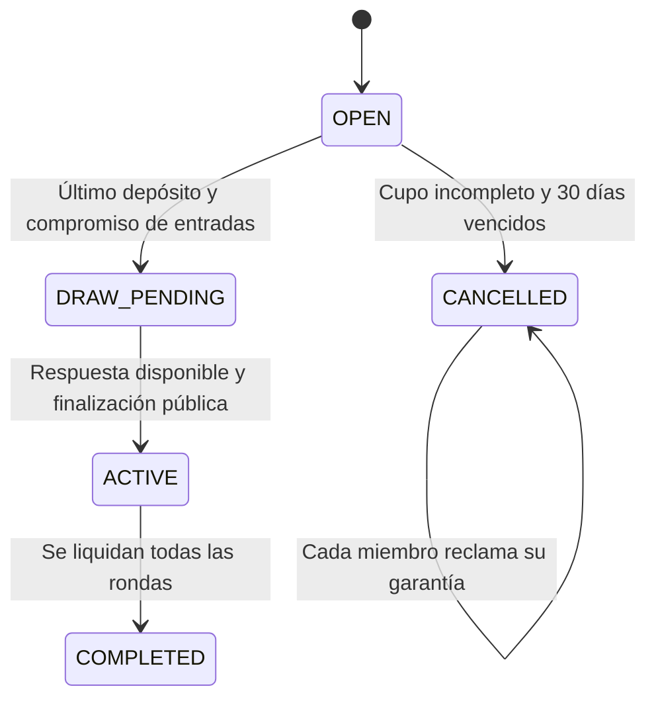

# Revisión y correcciones de blockchain y sorteo

Revisión inicial: 10 de noviembre de 2026, sobre `d012a87`. Correcciones posteriores en este árbol de trabajo.

## Resultado de la corrección

Se conserva la organización original: contratos Solidity en Foundry, fábrica de círculos, bóveda, reputación y una aplicación React/Viem. Se añadieron únicamente el proveedor de aleatoriedad y sus implementaciones, un verificador independiente y los estados necesarios para esperar el sorteo y devolver garantías de círculos incompletos.

**El sorteo ahora cierra las inscripciones antes de conocer la salida de la fuente.** Una respuesta no puede sustituirse y el círculo no puede volver a solicitarla ni cancelarse después de solicitar aleatoriedad. La finalización no utiliza timestamp, número de bloque, `prevrandao` ni decisiones del remitente como entradas aleatorias.

La aplicación local sigue siendo una **demostración con fuente simulada**, identificada en pantalla. No se afirma que esa simulación sea un VRF ni que resista al operador del nodo. Está implementado un adaptador para **Chainlink VRF v2.5**; su uso real necesita red compatible, coordinador oficial, suscripción financiada y registro del proveedor como consumidor. No se ha realizado una entrega VRF en una red pública como parte de esta validación.

**La sustentación no requiere contratar ese servicio.** La interfaz local genera una palabra con `crypto.getRandomValues`, pero quien envía la respuesta al proveedor simulado puede escoger una palabra diferente. La demo demuestra el compromiso de entradas, la conservación de una sola respuesta y la reconstrucción del orden; no acredita independencia ni imparcialidad de la fuente. Esto se indica tanto antes de finalizar el sorteo como en la evidencia mostrada después.

## Antes y después

| Hallazgo original | Corrección |
| --- | --- |
| El último inscrito podía escoger el primer turno ajustando el reloj. | Se eliminó el reloj virtual; la inscripción solo solicita aleatoriedad futura. |
| Se podía revertir una inscripción con turno desfavorable. | La inscripción no produce ni revela turnos. La respuesta llega después del compromiso de participantes y reglas. |
| Cualquier dirección podía forzar incumplimientos avanzando el tiempo. | El contrato utiliza exclusivamente el tiempo del bloque. Los botones de demo envían RPC a Anvil. |
| La garantía de 150 para cuota de 100 podía reducir un pozo de 300 a 240. | Garantía mínima para todas las cuotas y multas del ciclo. Cada incumplimiento conserva cobertura completa. |
| Un círculo sin completar podía retener depósitos indefinidamente. | Plazo de inscripción de 30 días; cancelación pública y devolución individual, una sola vez. |
| Cuentas nuevas podían otorgar avales inmediatamente. | Avalar requiere al menos un círculo completado sin mora y score mínimo de 500. |
| El propietario podía fabricar historial o autorizar círculos arbitrarios. | Solo la fábrica fijada una vez autoriza círculos; solo los círculos autorizados registran actividad. |
| La interfaz solo enseñaba una semilla abreviada. | Evidencia completa y reconstrucción en TypeScript, más herramienta de consola. |
| La documentación prometía interés compuesto. | Se describe el rendimiento acumulado sobre principal que realmente simula la bóveda. |

No se equipara dirección con persona: completar círculos entre múltiples wallets propias sigue siendo posible en un prototipo sin identidad independiente. La reputación requiere controles adicionales si determina crédito real.

## Flujo del sorteo



Se mantuvieron los valores previos de estado: `OPEN = 0`, `ACTIVE = 1`, `COMPLETED = 2`. Se añadieron `DRAW_PENDING = 3` y `CANCELLED = 4`.

1. La última inscripción congela participantes y reglas mediante un compromiso `keccak256(abi.encode(version, chainId, circle, params, participants))`.
2. El proveedor registra un único identificador de solicitud para ese círculo.
3. Chainlink valida la prueba en su coordinador; el adaptador autentica al coordinador y almacena una sola salida. El valor cero también es válido. Respuestas desconocidas, duplicadas o de longitud incorrecta no reemplazan una salida.
4. Cualquier dirección puede finalizar después. La semilla es `keccak256(abi.encode(version, commitment, requestId, word))`.
5. Fisher-Yates deriva muestras con `keccak256(abi.encode(seed, counter))`, rechazando muestras inferiores a `2^256 % bound` antes de reducir módulo `bound`. Esto elimina el sesgo de reducción bajo el modelo criptográfico de las muestras.
6. El contrato asigna cada turno e inicia el plazo de la primera ronda en la finalización, sin consumirlo durante la espera.

La versión del algoritmo es el hash de `NatiChain.Draw.v2`. La lista original, reglas, identificador, salida, semilla y orden quedan consultables. No hay función para modificar la lista cerrada, repetir el sorteo o retirar la garantía de un participante comprometido mientras se espera.

El proveedor utiliza la base oficial `VRFConsumerBaseV2Plus` de `@chainlink/contracts` 1.5.0. Ocho archivos originales se incluyen en [la dependencia local](../foundry/lib/chainlink/README.md). Se verifica además el coordinador original inmutable, de modo que una migración heredada no permita inyectar salidas de otra fuente.

## Qué se verifica y qué hipótesis permanecen

**Reproducibilidad** significa reconstruir el mismo orden a partir de evidencia pública. **Impredecibilidad previa** significa que un participante no puede conocerlo antes de quedar comprometido. **Imparcialidad** exige que no pueda escoger entradas o descartar resultados después. Son propiedades distintas; un hash público por sí solo no las garantiza.

La garantía del modo VRF depende de la criptografía, el coordinador oficial configurado, las confirmaciones elegidas y la seguridad de la red. No se promete azar físico perfecto ni imposibilidad matemática absoluta de predicción.

El adaptador conserva la administración de migración de la base oficial: el propietario o coordinador puede afectar disponibilidad cambiando la referencia heredada, pero una fuente distinta no puede producir salidas aceptadas por la comprobación inmutable. Una entrega legítima requiere que esa referencia apunte al coordinador original.

Si el servicio VRF no responde, el círculo permanece pendiente: deliberadamente no existe una semilla local de respaldo, cancelación elegible ni nueva solicitud que permita descartar resultados desfavorables. Debe supervisarse y financiarse el servicio. La aplicación no implementa una solución de recuperación de disponibilidad con garantías equivalentes. Un círculo que nunca llenó sus cupos sí puede devolver garantías antes de haber solicitado aleatoriedad.

La fábrica es pública. La suscripción financia solicitudes de círculos válidos, incluyendo círculos creados por terceros: antes de un servicio abierto con fondos reales debe definirse quién paga y cómo se limita el consumo de ese presupuesto.

## Reglas económicas conservadas y ajustadas

La garantía mínima es:

```text
penalty = floor(contributionAmount * latePenaltyBps / 10000)
minimumCollateral = maxParticipants * (contributionAmount + penalty)
```

Para tres miembros, cuota de 100 y multa del 10 %, cada garantía es como mínimo **330 cUSD**. Para cuatro miembros, cuota de 200 y multa del 5 %, es **840 cUSD**. La garantía es reembolsable salvo los descuentos por incumplimiento. Este requisito conservador reduce el acceso al crédito sin respaldo; es el costo de prometer cobertura íntegra con este modelo sencillo.

Se conservó el reparto por **pagos puntuales**, evitando cambiar la política original a exclusión de una persona por todo el ciclo: pagar tarde una ronda no elimina puntos ganados en otras. Si nadie tiene puntos, los premios se reparten por igual; es una regla explícita de contingencia, no un premio exclusivo a personas 100 % puntuales. La tabla y la sustentación deben describir esta política tal como está implementada.

La interfaz refleja también ese reparto sin puntos. Al finalizar muestra el premio realmente liquidado, incluyendo el residuo de división que recibe el primer miembro del orden sorteado. La garantía activa se presenta en cero y su saldo histórico se identifica como importe devuelto al cierre. En ASCA el orden sorteado se muestra como referencia: no se marca a nadie como cobrado antes de la liquidación final.

Los pagos posteriores o iguales al vencimiento se rechazan y la liquidación cubre el incumplimiento. Liquidar sigue requiriendo una transacción: no ocurre simplemente por pasar el tiempo.

Los botones de pago se deshabilitan al vencer la ronda. Antes de enviar pagos, la interfaz vuelve a consultar la ronda y comprueba que siga activa y sea la misma. El pago grupal confirma cada transacción, prepara la autorización de tokens cuando hace falta e informa los aportes confirmados y los pendientes; solo opera las cuentas locales de demo.

`MockStablecoin` y `MockYieldVault` siguen siendo simulaciones. La acuñación del faucet y del rendimiento no demuestra respaldo del token, beneficio económico ni cobertura real frente a inflación. No se reinvierten intereses.

## Verificación independiente

La pantalla del círculo incluye la evidencia y el botón **Verificar compromiso, semilla y orden**. El cálculo se realiza en [TypeScript](../web/src/contracts/draw.ts), sin llamar a la función de barajado Solidity.

También se puede comprobar desde una terminal con **Node >= 22.18**:

```powershell
cd web
npm run verify:draw -- 0xDIRECCION_DEL_CIRCULO
```

La herramienta consulta un solo bloque para evitar mezclar estados durante una finalización concurrente. Muestra JSON con red, bloque, proveedor, modo demo, compromiso, solicitud, salida, semilla, lista original y orden reconstruido. Devuelve un código de error si el sorteo no está finalizado o la evidencia no coincide. `RPC_URL` permite consultar otra red.

Esta herramienta verifica la transformación y la vinculación con las reglas y participantes. La prueba de origen VRF se comprueba en el coordinador configurado y en su transacción de entrega; no se reimplementa el verificador criptográfico de Chainlink en el navegador.

## Validación

Resultado ejecutado: **29 pruebas Solidity pasan** (incluyen 256 casos de fuzzing), **4 pruebas del verificador pasan**, TypeScript sin errores y compilación Vite correcta. El flujo de inscripción, espera, finalización simulada, verificación independiente y avance de tiempo se comprobó también desde la interfaz en Anvil.

Se mantienen las pruebas económicas de Cadena y Natillera y se ejecutan también contra el adaptador VRF con un coordinador de pruebas. Las pruebas actuales exigen que los ataques de la revisión inicial fallen; ya no son pruebas que pasan al demostrar vulnerabilidades.

Se cubren inscripción sin resultado observable, finalización prematura, remitentes no autorizados, respuestas duplicadas y fuera de orden, identificador incorrecto, palabra cero, migración de coordinador, prohibición de resorteo/cancelación pendiente, tiempo real, cobertura de todos los incumplimientos, devolución de garantías, pagos vencidos y límites de 2 y 50 participantes. El fuzzing comprueba permutaciones en todo el intervalo.

```powershell
cd foundry
forge test -vv
cd ../web
npm run typecheck
npm run test:draw
npm run build
```

La validación local no equivale a una entrega VRF real en testnet. Las instrucciones para configurarla están en el [README](../README.md).

### Comprobación de interfaz y scripts del 11 de noviembre de 2026

Se mantuvieron los contratos y la estructura de pantallas. Se volvió a ejecutar la suite: 29 pruebas Solidity correctas, incluidos 256 casos de fuzzing; cuatro pruebas del verificador correctas; TypeScript y compilación Vite correctos. Vite conserva la advertencia de tamaño del paquete principal superior a 500 kB; la compilación finaliza correctamente.

Se ejecutó desde la interfaz un ciclo ASCA con pagos tardíos, una ronda cubierta con garantías y cero puntos de puntualidad. Antes del cierre no aparecieron cobros anticipados; el premio estimado se repartió por igual. Al cerrar, los cuatro participantes mostraron garantía activa cero, garantía devuelta de 630 cUSD y premio liquidado de 184,90 cUSD. La verificación de consola de ese sorteo devolvió `valid: true`.

También se creó un círculo ROSCA con una cuenta del selector y otra externa, dejando la autorización de tokens de la cuenta local agotada. El pago grupal renovó la autorización, confirmó únicamente el aporte local y comunicó que la cuenta externa seguía pendiente. Tras el pago individual externo y la liquidación, la interfaz marcó un solo turno como cobrado y reconstruyó correctamente el sorteo. Se comprobó que ambos botones de pago quedaran deshabilitados al vencer una ronda.

Los scripts de inicio y apagado usan un registro local de identidad de procesos en `.demo/`, excluido de Git. Se comprobó inicio con direcciones deterministas, apagado de los servicios propios, conservación de otro nodo Anvil, conservación de una web no registrada, rechazo de un registro con identidad de proceso distinta y rechazo del inicio con el puerto 3000 ocupado. La demo quedó reiniciada con los dos círculos iniciales sin inscripciones.

### Corrección de cargas al cambiar de círculo

La selección del círculo y de la cuenta invalida inmediatamente el panel anterior. Cada resultado queda vinculado a la dirección del círculo, la cuenta que lo consulta y la versión de esa selección. Mientras se carga la nueva selección se muestra un mensaje de carga y no se presentan acciones ni evidencia del círculo anterior. Las respuestas de selecciones anteriores se descartan, incluso si se vuelve rápidamente al mismo círculo. Si falla la carga vigente se oculta el panel y se ofrece reintentar.

Las lecturas de una carga consultan el mismo número de bloque para mantener consistentes las reglas, los participantes, los pagos, la reputación y la evidencia del sorteo. Una respuesta más antigua tampoco puede sustituir un resultado completo más reciente de la misma selección.

Se comprobó en el navegador con respuestas RPC retrasadas: durante el cambio no aparecieron la dirección, el nombre, la evidencia ni los botones del círculo anterior. También se retuvieron cuatro consultas de un círculo, se seleccionó otro y se liberaron después las respuestas anteriores; el nombre y la dirección siguieron correspondiendo a la última selección. No se enviaron transacciones durante estas pruebas.
